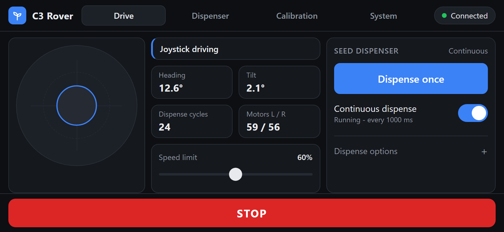
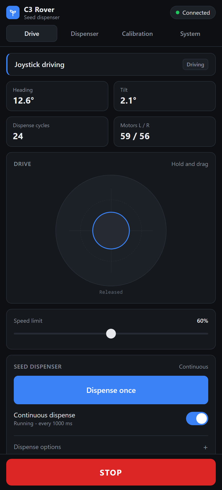
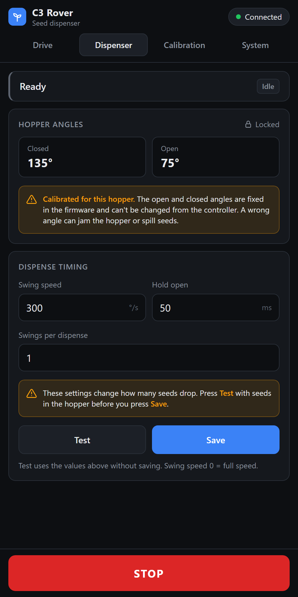
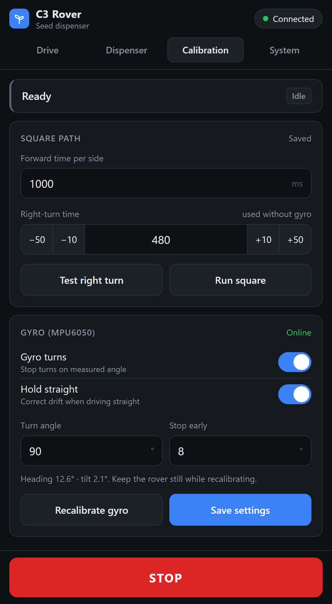
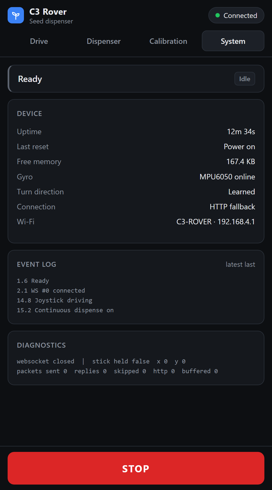

# 🌱 Seed Dispensing Rover — ESP32-C3

A four-wheel, Wi-Fi controlled seed-sowing rover built on an **ESP32-C3 Super Mini**. The rover hosts its own controller page: connect a phone to the rover's Wi-Fi, open the browser, and drive with a touch joystick while a servo-driven hopper drops seeds on demand or at a fixed interval.

An **MPU6050** gyro gives accurate 90° turns, keeps the rover driving straight, and stops everything if the rover tips over. Firmware updates go over Wi-Fi (OTA), so the cable only has to be plugged in once.

<p align="center">
  
</p>

<p align="center">
  
  
  
  
</p>

## ✨ Features

**Driving**
- Smooth proportional joystick (arcade mixing) over a WebSocket, about 10 commands per second
- Soft starts (gentle build-up from a stop, so the driver never cuts out), a braked pass through zero when reversing
- Speed limit slider (20–100 %), remembered on the phone
- Gyro "hold straight": corrects drift when the stick is pushed straight ahead or back
- Slow-decay PWM at 1 kHz on the DRV8833 for full torque from BO motors on pivot turns

**Seed dispensing**
- **Dispense once**, or **continuous dispense** at a set interval while driving
- Adjustable swing speed, cycles per drop, and interval
- Hopper angles are locked in the firmware (closed 135°, open 75°), so the dispenser can't be mis-set from the controller
- Dispense timing (swing speed, hold time, swings) can be tested before saving, and Save asks for confirmation
- The Drive tab always uses the saved dispense settings
- Counts completed dispense cycles since power-on

**Navigation and calibration**
- Gyro-measured 90° turns, with a "stop early" setting to allow for coasting
- Square-path test (4 × forward + right turn) to check straight-line driving and turning together
- The gyro learns which way is "right" from the first test turn and saves it
- Timed turns are used automatically if the MPU6050 is missing

**Safety**
- Large **STOP** button on every screen (stops the motors, servo and continuous dispense)
- Stops the motors if joystick packets stop for 500 ms, or if the phone disconnects
- Continuous dispense switches off if the controller page goes away
- Tilt cut-out above 35°; driving resumes after 1 s back below 25°
- Motor driver held in standby until the PWM pins are in a safe state at boot

**System**
- Self-hosted dashboard: no app and no internet needed
- Over-the-air firmware updates (ArduinoOTA)
- All settings saved in flash (ESP32 NVS / Preferences)
- System tab: uptime, last reset reason (detects brownouts and battery dips), free memory, event log

## 📁 Repository structure

```text
Seed-Dispensing-Rover/
├── README.md
├── firmware/
│   ├── C3_Seed_Rover/
│   │   └── C3_Seed_Rover.ino        ← main firmware (controller page included)
│   └── tools/
│       └── C3_Turn_Calibrate/
│           └── C3_Turn_Calibrate.ino ← minimal left/right turn timing test
├── hardware/
│   └── wiring.md                    ← full connections, power and capacitors
├── docs/
│   ├── calibration.md               ← first-time setup and tuning
│   └── troubleshooting.md
└── images/                          ← controller screenshots
```

## 🧰 Hardware

| Part | Notes |
|---|---|
| ESP32-C3 Super Mini | Main controller, Wi-Fi access point |
| DRV8833 dual motor driver | One channel per side |
| 4 × BO gear motors | Two in parallel per side (skid steering) |
| MPU6050 (GY-521) | Gyro and accelerometer over I2C |
| Micro servo (SG90 / MG90S) | Opens and closes the seed hopper |
| 2S Li-ion pack + 2S BMS | 7.4 V nominal, 8.4 V full. Use a BMS rated for the motors' starting current |
| Buck converter set to 5.0 V | Powers the ESP32-C3 and the servo |
| Power switch, optional 3–5 A fuse | |
| Capacitors | 470–1000 µF at the DRV8833, 470 µF at the servo |

## 🔌 Pin configuration

```text
GPIO 3   -> DRV8833 AIN1   (left motors)
GPIO 4   -> DRV8833 AIN2   (left motors)
GPIO 5   -> DRV8833 BIN1   (right motors)
GPIO 6   -> DRV8833 BIN2   (right motors)
GPIO 7   -> DRV8833 STBY / EEP / nSLEEP
GPIO 10  -> Servo signal
GPIO 20  -> MPU6050 SDA
GPIO 21  -> MPU6050 SCL
3V3      -> MPU6050 VCC
5V       <- Buck converter 5.0 V
GND      -> common ground (battery, DRV8833, buck, servo, MPU6050)
```

Full wiring, power distribution and capacitor placement: **[hardware/wiring.md](hardware/wiring.md)**

## 💻 Building the firmware

**Arduino IDE settings**

| Setting | Value |
|---|---|
| Board package | esp32 by Espressif, **3.x** (tested on 3.3.x) |
| Board | ESP32C3 Dev Module |
| USB CDC On Boot | Enabled |
| Partition scheme | Default 4MB with spiffs (keeps the OTA partitions) |

**Library:** install **WebSockets** by Markus Sattler (2.7.x) from the Library Manager. `WiFi`, `WebServer`, `Preferences`, `ArduinoOTA` and `Wire` come with the ESP32 core.

The firmware uses the ESP32 core 3.x LEDC API (`ledcAttach` / `ledcWrite`).

**First upload:** open `firmware/C3_Seed_Rover/C3_Seed_Rover.ino`, connect the board over USB, and upload. Close the Serial Monitor first, or the port stays busy.

**Later uploads (OTA):**
1. Connect the PC to the rover's Wi-Fi. The rover accepts one device at a time, so disconnect the phone first.
2. In the Arduino IDE, pick the network port **c3-rover at 192.168.4.1** and upload. The OTA password is `12345678`.

You can also upload from the command line:

```bash
espota.exe -i 192.168.4.1 -p 3232 --auth=12345678 -f C3_Seed_Rover.ino.bin -r
```

## 📱 Using the controller

1. Switch the rover on and **keep it still for about 2 seconds**. The gyro calibrates at power-up.
2. On the phone, join Wi-Fi **C3-ROVER** (password `12345678`) and open **http://192.168.4.1**.
3. Optional: use the browser's **Add to Home screen** so it opens like an app.
4. Turn the phone sideways for the cockpit layout: joystick on the left, stats in the middle, dispenser on the right.

| Tab | What it does |
|---|---|
| **Drive** | Joystick, speed limit, heading, tilt, motor output, dispense once / continuous |
| **Dispenser** | Locked hopper angles (read-only), and dispense timing: swing speed, hold time, swings per drop |
| **Calibration** | Square-path timing, gyro turns, hold straight, turn angle, gyro recalibration |
| **System** | Uptime, last reset reason, memory, gyro status, event log, diagnostics |

First-time setup steps: **[docs/calibration.md](docs/calibration.md)**

## ⚙️ How it works

```text
Phone browser ──Wi-Fi AP──> ESP32-C3
   │  HTTP :80        page, settings, dispense, STOP
   │  WebSocket :81   joystick "x,y,speed" (10 Hz) + status requests
   ▼
ESP32-C3 main loop (non-blocking, millis() state machines)
   ├── joystick  → arcade mix → ramp → DRV8833 (slow-decay PWM, 1 kHz)
   ├── MPU6050   → 200 Hz gyro Z integration (heading) + accel tilt
   ├── sequences → test turn / square path (time- or gyro-based)
   ├── servo     → speed-limited open → hold → close cycles (50 Hz LEDC)
   └── safety    → link timeouts, tilt latch, STOP
```

- **Motor drive.** Slow decay holds one DRV8833 input high and drives the other with an inverted PWM. Between pulses the motor brakes instead of coasting, which keeps the current up and gives BO motors far more torque at the same duty cycle. With fast decay, one side often stalled on pivot turns.
- **Joystick.** Throttle and steering are mixed into left/right demand. The speed slider spans the usable range: 20 % = the minimum drive power (default PWM 110, adjustable on the Calibration tab), 100 % = PWM 200. Starts are soft: a side leaving standstill begins at PWM 60 and speeds up at 300 PWM/s. A sudden large step into stalled motors trips the DRV8833's over-current protection, which makes the motors hum without moving. Slowing down and stopping use 900 PWM/s. While the stick is held, the page sends only joystick packets.
- **Gyro.** The MPU6050 is read with raw I2C registers (±500 °/s, 44 Hz low-pass), with no external library. Gyro drift is measured at boot. A turn ends at *turn angle − stop early*, and the real angle is reported once the rover stops coasting. Hold-straight is a proportional correction (±40 PWM maximum).
- **Status.** The page asks for status over the existing WebSocket. HTTP polling is only a fallback.

## 🌐 HTTP API

| Endpoint | Purpose |
|---|---|
| `/` | Controller page |
| `/status` | JSON status (also available over the WebSocket by sending `s`) |
| `/stop` | Stop motors, servo and continuous dispense |
| `/joy?x=&y=&s=` | Joystick fallback (x, y −100…100, s = speed %) |
| `/disp?sp=&n=` | Dispense once (swing speed °/s, cycles) |
| `/cont?on=&sp=&n=&i=` | Continuous dispense on/off (i = interval ms) |
| `/servo/test?sp=&h=&n=` | Test dispense with the given timing (not saved) |
| `/servo/save?sp=&h=&n=` | Save dispense timing (the angles are locked) |
| `/test?turn=` | Test a right turn |
| `/square` | Run the square path |
| `/save?fwd=&turn=&ta=&tt=&gy=&hh=` | Save the square and gyro settings |
| `/mpu/cal` | Recalibrate the gyro (rover must be still) |
| `/drive/save?jm=` | Drive power: minimum PWM while moving (60-180) |
| `/log` | Recent event log (text) |

WebSocket on port **81**: send `x,y,speed` to drive, `0,0` to release, `s` for status.

## 🔧 Troubleshooting

See **[docs/troubleshooting.md](docs/troubleshooting.md)**. The most common causes:

- **Rover restarts or Wi-Fi drops when the motors start:** the battery is low, or the BMS trips on the starting current. Check *Last reset* on the System tab.
- **The page won't load on the phone:** another device (often the PC) is connected. The rover allows one device at a time.

## 🚀 Possible improvements

- Battery-voltage monitoring with a low-battery warning (resistor divider on a free ADC pin)
- Wheel encoders for distance-based rows instead of time-based
- Row-by-row autonomous sowing using the gyro heading
- Seed-level sensing in the hopper

## 👤 Author

**Ilaparti Rajasekhar** — [GitHub](https://github.com/Rajasekhar-Ilaparti) · [Portfolio](https://rajasekharilaparti-portfolio.netlify.app/)
